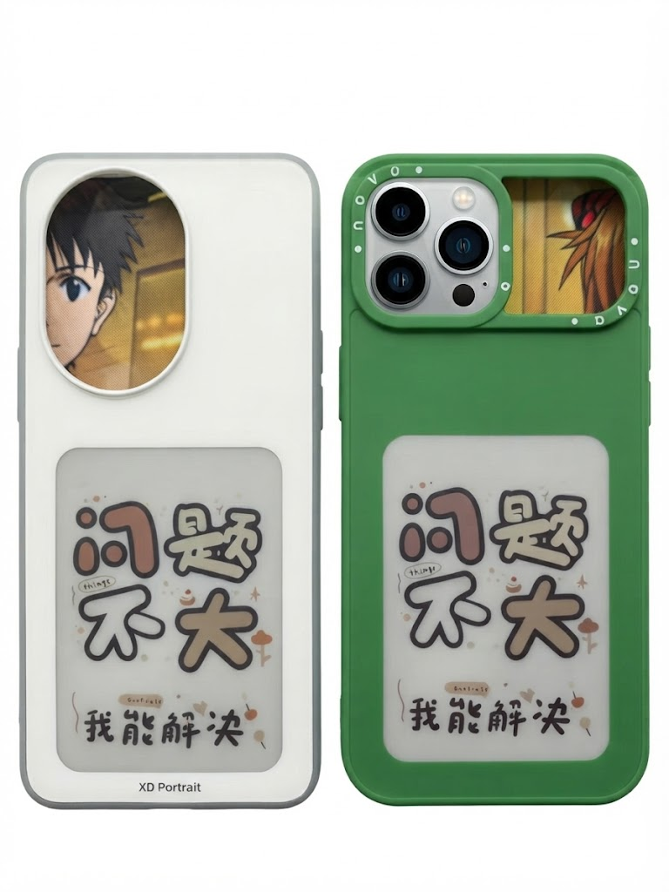
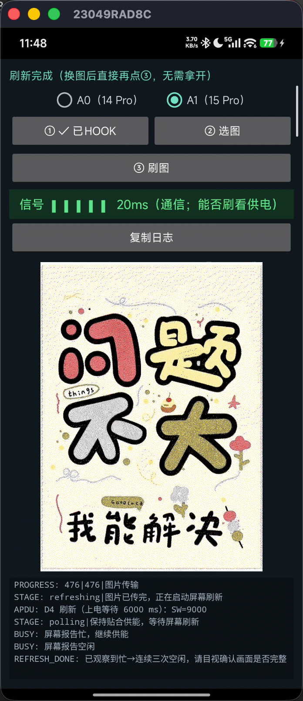

# eink-qpoll-flash

在**非华为、已 Root 的 Android 手机**上，给**华为 552×768 四色墨水屏手机壳**刷图的工具。

> 整套代码是和 **Claude Code**（Anthropic 的命令行 AI 编程工具）结对写出来的——从排查设备、设计方案、逐版实现到真机联调，全程人机协作完成。

## 效果

<table>
<tr>
<td align="center"><b>实拍：刷好的墨水屏壳</b></td>
<td align="center"><b>App 界面（刷新完成）</b></td>
</tr>
<tr>
<td></td>
<td></td>
</tr>
</table>

## 它解决什么问题

华为四色墨水屏壳只认一帧 **7-bit `0x7A`** 的寻卡信号（NXP 控制器的私有 **Q-Poll**，NCI tech `0x71`）；而标准 Android NFC 栈只发 NFC-A（`0x00`），于是普通手机"看不到"这个壳。

本项目用**两层**把它跑通：

- **Layer 1 · 唤醒桥（需 Root）**：用 `frida-inject` 把一段 NCI 改写脚本注入 `com.android.nfc`，在协议层把 `0x00 ↔ 0x71` 双向翻译，让壳子在系统眼里变成一张**标准 NFC-A / ISO-DEP 标签**。注入一次即可（进程重启或开机后需重注入）。
- **Layer 2 · 刷图 App（无需 Root）**：标准 Android NFC 应用，用前台 dispatch 抓到那张标签，跑 `D1/D8/D3/D4/DE` 协议完成选图→四色量化→上传→刷新。

> 这条"Root 注入桥 + 普通 App 刷图"的组合，已在 **Redmi Note 12 Turbo（marble / NXP SN110T / Android 15 / KernelSU）** 真机验证可刷图。

## 适用条件

- 手机：**NXP SN100 系控制器**（如 marble），已 Root（KernelSU / Magisk 均可，临时 Root 也行）。
- 屏幕壳：华为 552×768 四色墨水屏（A0 / A1 两种控制器排布）。
- 电脑端构建：JDK 17、Android SDK platform **android-34** + build-tools **34.0.0**、`xz`。
- 已验证设备：**Redmi Note 12 Turbo/ NXP SN110T / Android 15 / KernelSU **

<!-- MORE -->

## 构建

```sh
export ANDROID_SDK_ROOT=~/Library/Android/sdk   # 指向你的 SDK
export JAVA_HOME=/path/to/jdk-17
bash build.sh
adb install -r build/eink-qpoll-flash-debug.apk
```
脚本直接用 `aapt2 / javac / d8 / zipalign / apksigner`，无 Gradle、无构建期下载。首次构建自动生成 debug 签名。

## 使用

1. **① 注入 Hook**：点一下并授权 `su`。成功后按钮显示「✓ 已Hook」，并会自动重启一次 NFC 寻卡使其立即生效。**每次开机/`com.android.nfc` 重启后需重注入一次**。
2. **选屏幕类型**：**A0（华为/荣耀 14 Pro 壳）** 或 **A1（15 Pro 壳）**。选错图像会左右错位/对称，换一个即可。
3. **② 选图**：选一张图，上方显示四色预览（黑/白/黄/红）。长按「选图」可载入定位测试图。
4. **贴壳 → ③ 刷图**：把壳子贴到手机 NFC 区域。贴上后顶部**信号条**会自动显示连接质量（仅代表通信，不代表供电是否够刷）。日志出现 `D1/D3/D4/DE`、最后弹「刷新完成 ✅」即成功。
5. 刷成功后换图可**直接再点③**，无需拿开；只有掉电/离场才需重新贴。

### 关于"刷不动 / 供电不足"
四色刷新瞬间电流很大，耦合不够时会在刷新途中掉电（日志 `68CA` 或 `Tag out of date/TagLost`）。可用的办法：
- 换到**线圈耦合最好的位置、压紧别动**；
- **长按顶部状态栏**展开隐藏的「上电等待」高级选项，调大（默认 6s，可到 12s）——给屏幕更多预充电时间，有机会靠存电撑完刷新。
- 实测：**轻量信号满格也不保证能刷成**，最终以刷新结果为准。

## 参考与致谢

本项目站在这些开源/公开项目的肩膀上：

| 复用内容 | 来源 | 许可 |
| --- | --- | --- |
| 刷图协议（D1/D8/D3/D4/DE）、四色点阵布局、A0/A1 行映射、LZO1X literal | [kur0neko/huawei-epd-pn532](https://gitee.com/kur0neko/huawei-epd-pn532) | PolyForm Noncommercial 1.0.0 |
| 协议/图像的 Java 实现（`PanelProtocol`/`PanelType`/`ImageRaster`/`ImageBlocks`/`PanelImage`，本项目直接改编） | [ZhaoGY-N/huawei-nfc-eink-android-app](https://github.com/ZhaoGY-N/huawei-nfc-eink-android-app) | 同上 |
| `frida-inject` 自注入思路、工程脚手架 | [wiwiwei/ink-nfc-lab](https://github.com/wiwiwei/ink-nfc-lab) | PolyForm Noncommercial 1.0.0 |
| NCI `0x71` Q-Poll 桥接脚本 `assets/nfcq-hook.js` | [nfc-qpoll-ksu](https://github.com/Freeze-Over/nfc-qpoll-ksu) | MIT |
| `frida-inject`（17.24.0 arm64 官方发行） | [frida/frida](https://github.com/frida/frida) | wxWindows Library Licence |

`assets/nfcq-hook.js` 与上游 `nfc-qpoll-ksu/gadget/hook.js` 逐字节一致，未改动逻辑。

## 许可

因协议/图像核心改编自采用 **PolyForm Noncommercial 1.0.0** 的上游（kur0neko），**本项目整体同样采用 PolyForm Noncommercial 1.0.0，仅限非商业用途**，并保留必需署名 `Copyright (c) 2026 kur0neko`。详见 [LICENSE](LICENSE) 与 [NOTICE](NOTICE)。

## 风险

- 刷机/Root 有风险；Hook 生效期间普通 NFC-A 卡/门禁会扫不到（删除 Hook 或重启即恢复）。
- 仅在 marble / NXP SN110T / Android 15 路径验证；换机型需自行核实库名、符号与 A0/A1。
- 仅用于你本人拥有的设备与配件，遵守当地法律与配件厂商条款。

