# Redmi Note 12 Turbo · 华为四色墨水屏壳刷图图文教程

> 本教程走 **DirtyFrag 临时 Root** 方案（重启后失效，需重做）。

> ⚠️ **风险提示**：刷机 / Root 有风险，操作不当可能导致手机变砖、丢失数据或失去保修。
> 请先备份重要数据、确认能进入 recovery / fastboot，所有操作**风险自负**，仅用于你本人拥有的设备与配件。

全程两大步：**① 把手机 Root 好 → ② 用 App 刷图**。

---

## 一、前置准备（临时Root手机）

目标：让手机获得 Root 权限（KernelSU）。

1. 下载并安装这两个 APK：
   - **KernelSU 管理器**：<https://github.com/tiann/KernelSU/releases>
   - **DirtyFrag**：<https://github.com/mitschud/DirtyFrag/releases/>
2. 按工具说明完成**临时 Root**。
3. 完成标志：打开 **KernelSU** App，能看到设备已获授权、可给其它 App 发放 Root。

<table>
<tr>
  <td align="center">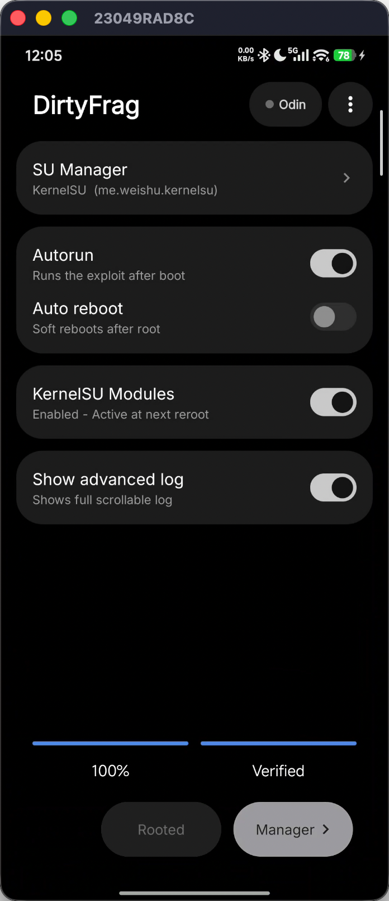 完成临时 Root</td>
  <td align="center">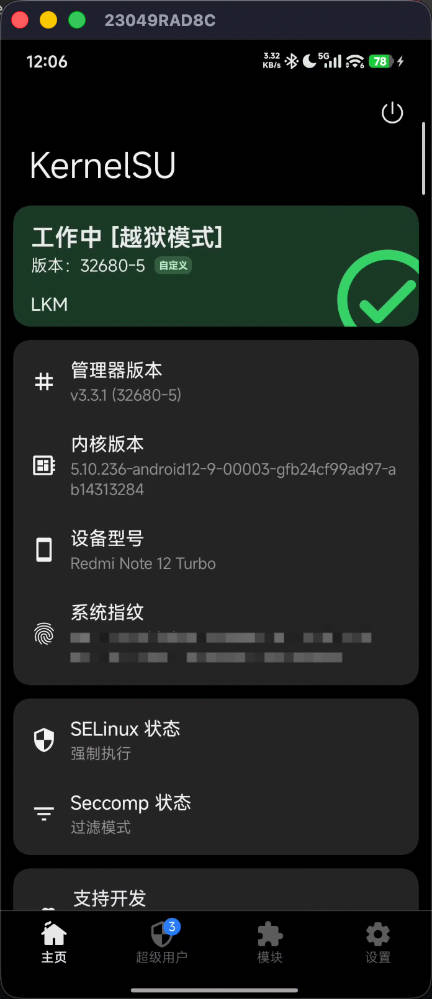 KernelSU 显示已授权</td>
</tr>
</table>

> 📺 详细 Root 步骤参考视频：[两秒 Root 神器 DirtyFrag 实测：免解 BL 三步上车【搞机纪年】](https://www.bilibili.com/video/BV1EdJy6GEjL/)

---

## 二、软件操作（刷图）

### 1. 下载安装 App

到 Release 页下载最新版 APK 并安装（debug 签名，安装时允许“未知来源”）：
<https://github.com/imyhui/eink-qpoll-flash/releases/tag/v1.0>

### 2. KernelSU 授权

打开 **KernelSU**，在第二个 tab 找到本 App，给予 Root 权限。

<table>
<tr>
  <td align="center">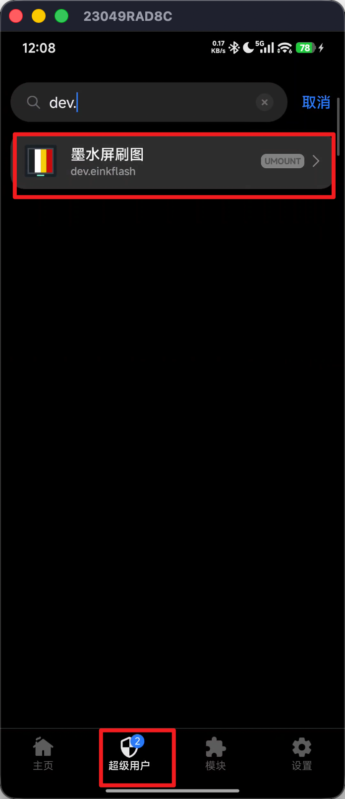 在列表找到本 App</td>
  <td align="center">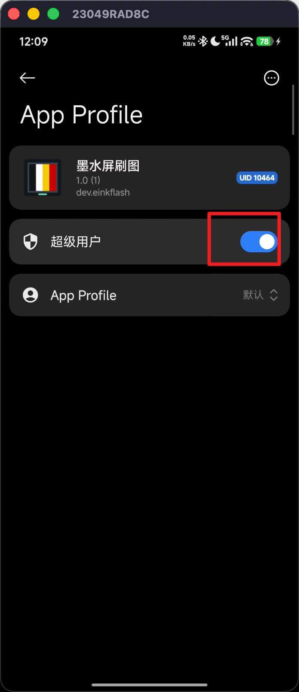 给予 Root 权限</td>
</tr>
</table>

### 3. 注入 Hook

点 **「① 注入Hook」**，按钮变为 **「✓ 已HOOK」**，并会自动重启一次 NFC 使其生效。

> 💡 **Hook 每次开机后需重做一次**（重启手机或 NFC 服务后会失效，再点一次即可）。

<table>
<tr>
  <td align="center">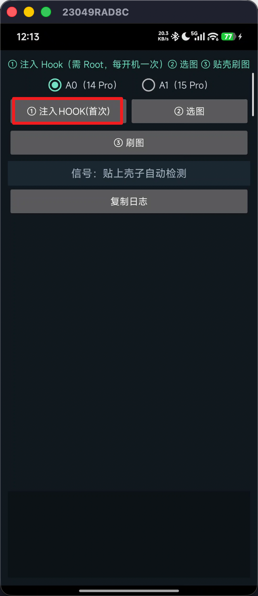 点击「① 注入Hook」</td>
  <td align="center">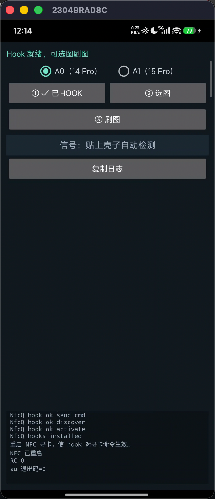 显示「✓ 已HOOK」</td>
</tr>
</table>
### 4. 找信号（对位）

1. 选屏幕类型：**A0（14 Pro 壳）** 或 **A1（15 Pro 壳）**——选错图像会错位，换另一个即可。
2. 把壳子贴到**手机背面 NFC 感应区**，建议按下图位置摆放。
3. 看顶部**信号条**：格数越多、ms 越小代表连接越稳。慢慢挪动壳子找到最稳位置并**压紧别动**。

<table>
<tr>
  <td align="center">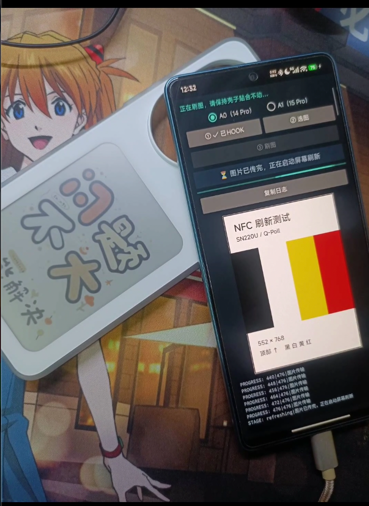 14 Pro 摆放位置</td>
  <td align="center">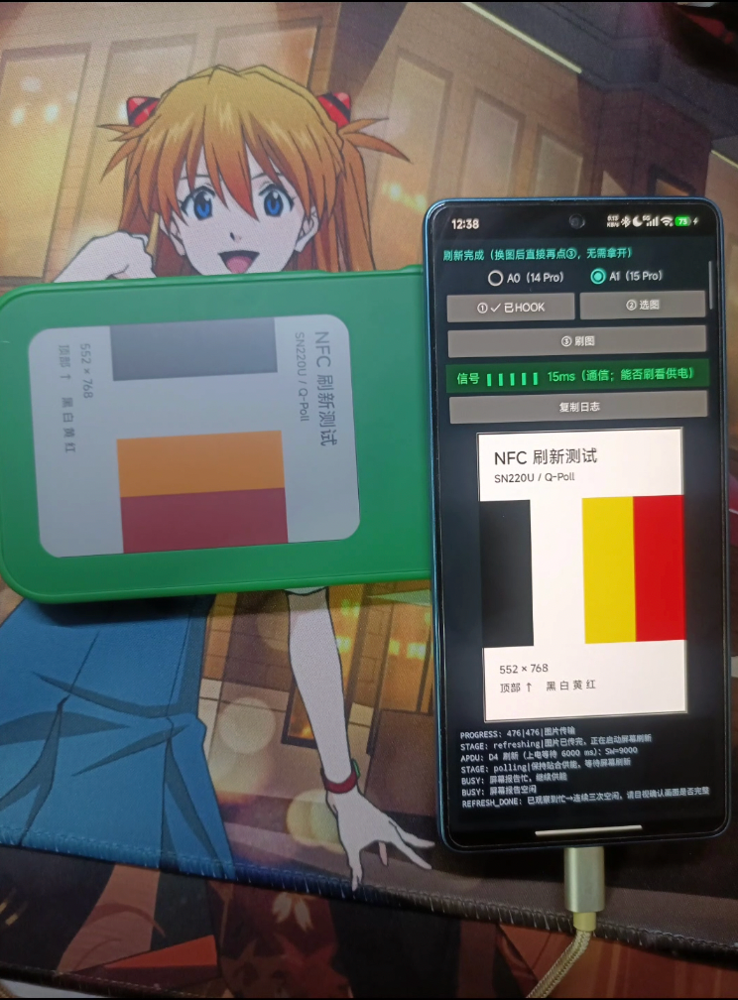 15 Pro 摆放位置</td>
</tr>
</table>

### 5. 刷图

1. 点 **「② 选图」** 从相册选图；**长按「② 选图」** 则加载内置测试图。
2. 保持贴合，点 **「③ 刷图」**，全程按住别动。
3. 进度条走完、弹出 **「刷新完成 ✅」**，墨水屏更新即成功。换图可**直接再点③，无需拿开**。

<table>
<tr>
  <td align="center">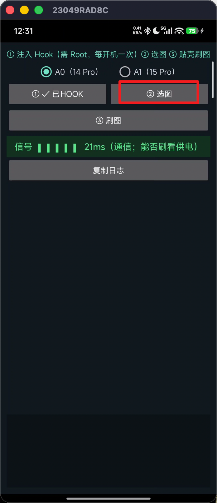 ② 选图</td>
  <td align="center">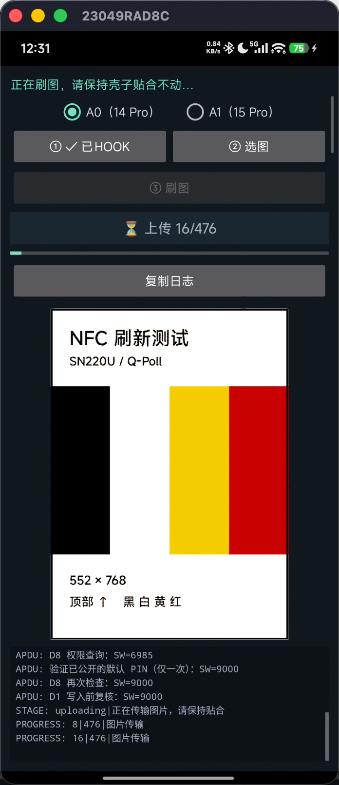 ③ 刷图</td>
  <td align="center">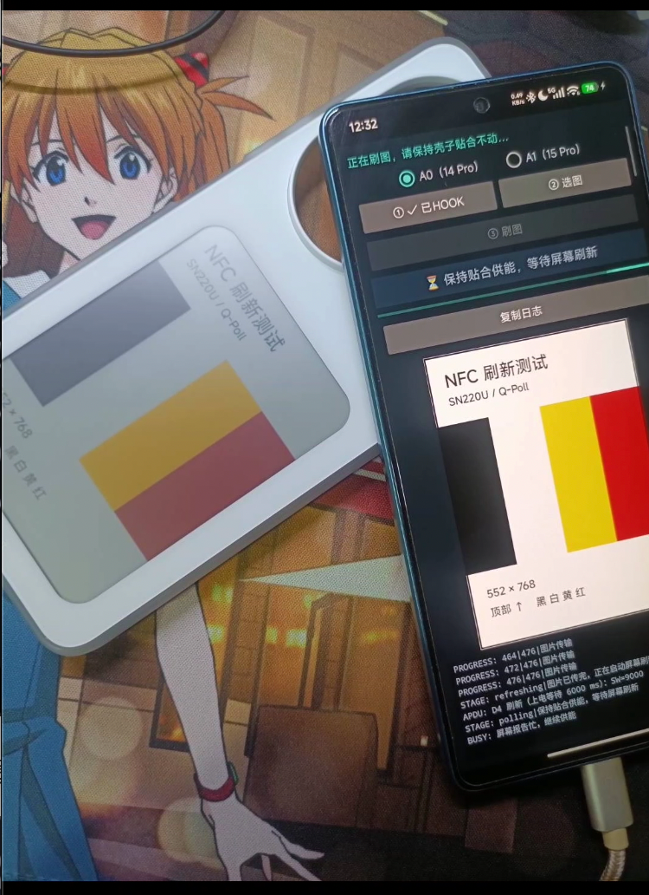 刷图进行中</td>
</tr>
<tr>
  <td align="center">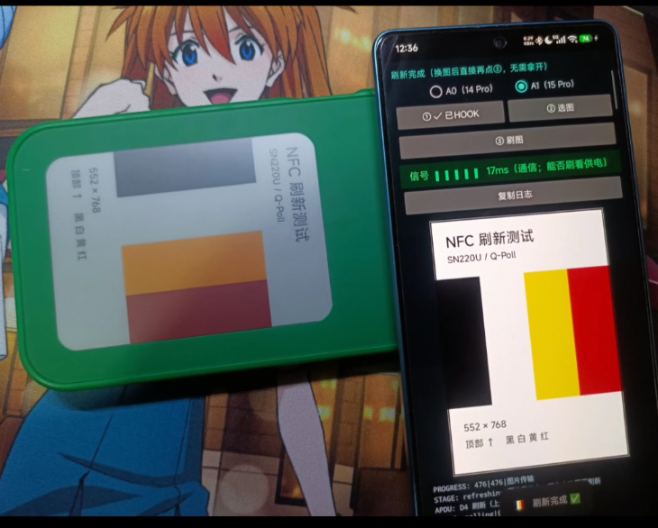 刷图完成</td>
  <td align="center">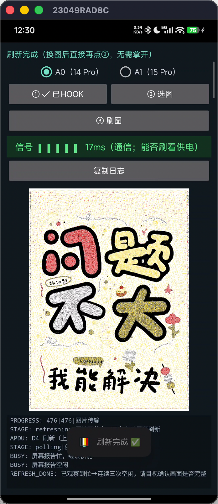 刷新完成 ✅</td>
  <td></td>
</tr>
</table>

> 🔋 **刷不动 / 提示“供电不足”**：说明耦合电量不够。办法：换到最稳位置并压紧；或**长按顶部状态栏**调出「上电等待」，调大（默认 6s，可到 12s）再刷。

---

## PS：Hook 之后也能直接用「墨小家」

注入 Hook 后，壳子在系统眼里就是一张普通 NFC 标签——所以除了本 App，**官方「墨小家」也能直接识别并刷图（貌似只支持 14）**。本 App 多了四色预览、对位信号、上电等待等更顺手的功能，按喜好选用即可。

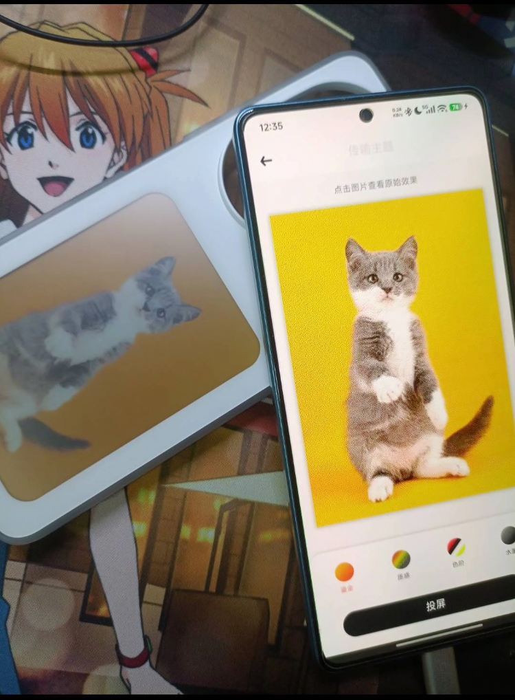 「墨小家」识别到壳子，并传图

---

*仅限非商业用途（PolyForm Noncommercial 1.0.0）。协议改编自 kur0neko/huawei-epd-pn532，参考 ZhaoGY-N/huawei-nfc-eink-android-app、wiwiwei/ink-nfc-lab、nfc-qpoll-ksu；与 Claude Code 结对编写。*

